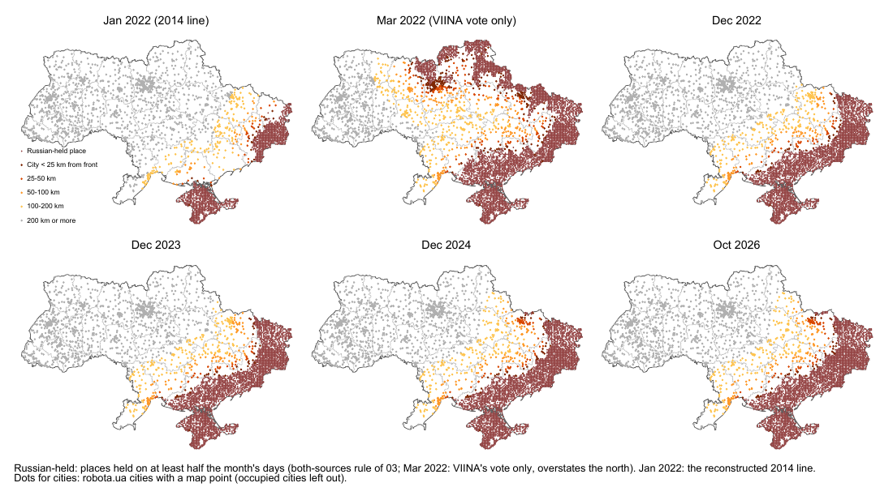
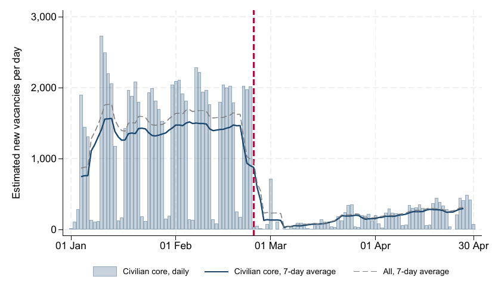

# War exposure and labor demand in Ukraine

Code for my MSc thesis (Bocconi University, in progress). The question is how local exposure
to Russia's full-scale invasion (air-raid alarms, distance to the front line, attacks nearby)
changes **firms' demand for labor**: how many vacancies they post, where, at what wage and
with what requirements.

The data are a **random third of all vacancy IDs** on robota.ua, one of Ukraine's largest job
boards, from October 2020 to November 2026: about 780,000 vacancies, which I collected myself.
The same share of IDs is sampled in every period, so firms can be followed over time and
counts compare across periods. I link the vacancies to three sources: hourly air-raid alarms
by district (raion), daily territorial control and attacks by settlement (VIINA), and the
district map.

   
  <em>Distance of robota.ua cities to the front line, built from VIINA settlement-level control data.</em>

   
  <em>Estimated new vacancies per day around 24 February 2022.</em>

## What's in here

| Folder | Contents |
|---|---|
| `do/` | The pipeline: `00_main.do` runs everything in order. Python helpers (`00_*.py`) handle what Stata does badly (Parquet text files, point-in-polygon, regex on Ukrainian/Russian text); Stata does cleaning, exposure measures, descriptives and the main designs (PPML with high-dimensional fixed effects). |
| `data/crosswalks/` | Hand-built code lists: city → raion, robota.ua dictionaries, and a rule-based job title → ISCO-08 crosswalk (regex rules in Ukrainian and Russian). |
| `output/` | Descriptive figures (PDF) and tables (`.xlsx` + `.tex`), generated by the code. |
| `docs/` | [`pipeline.md`](docs/pipeline.md): full technical documentation (every script, analysis file, and methodological choice). [`exposure_viina_spec.md`](docs/exposure_viina_spec.md): specification of the front-line and attack measures. |

## Some of the work involved

- **Sampling design.** The vacancy IDs are sampled at the same rate in every year's ID range, so
  weighted counts estimate the population and period and employer fixed effects absorb the
  sampling rate. The period comes from the ID, not from the (republication) date.
- **Exposure measures.** Alarm hours by raion and month with overlapping alerts merged, in local
  time, on a balanced panel where occupied areas are missing rather than zero; a replication of
  the oblast-level measure in the literature as a benchmark; distance to the nearest
  Russian-held settlement and attack days within 15 km from VIINA, with control coded only when
  two independent sources agree.
- **Geography.** Every city gets a raion from its vacancies' map pins (point-in-polygon on the
  median pin, after dropping the site's default Kyiv pins), checked by hand for ambiguous names.
- **Text.** Dictionary-based flags on titles and descriptions (requirements, targeting of women,
  veterans or pensioners, mobilization deferment, air-raid shelters, backup power, relocation),
  and ISCO-08 occupations from job titles.

## Reproducing

The vacancy data are not shared: the descriptions contain recruiters' names and contact details.
The public inputs are the
[air-raid sirens dataset](https://github.com/Vadimkin/ukrainian-air-raid-sirens-dataset)
and [VIINA](https://github.com/zhukovyuri/VIINA). The pipeline expects this repository in a
folder named `Project/`, with the input folders next to it (see `docs/pipeline.md`, §1–2).
Run `do/00_main.do` from the repository root. It was developed on StataNow 19 (`reghdfe`, `ftools`,
`ppmlhdfe`, `encoder`) and Python 3 with pandas, numpy, pyarrow and scipy.

## Credits

The occupation crosswalk (`occupation_groups.csv`, `occupation_rules.csv`) was first built on
the Kyiv School of Economics Work.ua data (CC BY-NC 4.0). Territorial control and events: VIINA
(Zhukov). Alarms: the Ukrainian air-raid sirens dataset (Vadimkin). District boundaries: OCHA
COD-AB.

## License

[CC BY 4.0](https://creativecommons.org/licenses/by/4.0/), except the two KSE-based
occupation crosswalk files, which are [CC BY-NC 4.0](https://creativecommons.org/licenses/by-nc/4.0/).
See [LICENSE](LICENSE).
